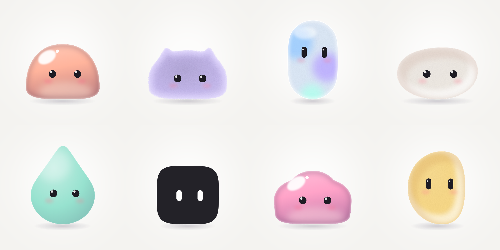

<p align="center">
  <a href="https://victoriawu-77.github.io/blob-atelier/"></a>
</p>

<h1 align="center">Blob Atelier</h1>

<p align="center"><b>Design a cute animated mascot for your AI agent. One HTML file.</b></p>

<p align="center">
  <a href="https://victoriawu-77.github.io/blob-atelier/"><b>Try it →</b></a> &nbsp;·&nbsp;
  <a href="assets/demo.mp4">Watch the 12s demo</a> &nbsp;·&nbsp;
  <a href="agent-mascot.js">agent-mascot.js</a>
</p>

---

Pick a shape, a finish and a color, and you get a mouthless little blob that breathes, blinks, follows your cursor and squishes when you poke it. Then drop it into your agent's UI with one tag. It's vanilla JS and inline SVG, with no build step and no dependencies.

## Features

- **8 shapes**, all morphing smoothly into each other: mochi, bean, pebble, squircle, pill, drop, bun, cloud
- **6 finishes**: matte, soft, jelly, frosted glass, clay, velvet
- **11 colors**, dot or capsule eyes, and optional blush
- **Motion**: spring physics, idle breathing, random blinks, cursor-following eyes with a pseudo-3D turn, and squash-and-stretch when you click or drag
- **8 agent states** you can switch from code (see below)
- **Randomize with taste**: only pairs finishes and colors that work together
- **Export** to SVG, PNG (transparent), GIF, WebM, or an embeddable web component
- Your design is saved in the URL hash, so every mascot is a shareable link

## Embed

```html
<script src="https://victoriawu-77.github.io/blob-atelier/agent-mascot.js"></script>

<agent-mascot shape="mochi" color="peach" material="jelly" eyes="dot" state="idle"
              style="width:240px;height:240px"></agent-mascot>
```

```js
const mascot = document.querySelector('agent-mascot');

mascot.setState('thinking');          // switch state
mascot.setConfig({ shape: 'cloud', color: '#9CCBFF', material: 'glass' });
mascot.poke();                        // a little squish
mascot.lookAt(0.5, -0.3);             // hold the gaze (x, y in -1..1); lookAt(null) to release
mascot.addEventListener('change', e => console.log(e.detail));
```

| Attribute  | Values |
|------------|--------|
| `shape`    | `mochi` `bean` `pebble` `squircle` `pill` `drop` `bun` `cloud` |
| `material` | `matte` `soft` `jelly` `glass` `clay` `velvet` |
| `color`    | `milk` `peach` `butter` `matcha` `mint` `sky` `lilac` `bubblegum` `tangerine` `cocoa` `ink`, or any hex |
| `eyes`     | `dot` `capsule` |
| `cheeks`   | `true` `false` |
| `state`    | see below |

In the app, **Embed → Copy standalone** gives you a fully self-contained snippet with the component inlined.

## States

| State       | What it does |
|-------------|--------------|
| `idle`      | Breathes, blinks, looks around |
| `listening` | Soft rings pull inward, eyes grow, head tilts and nods |
| `thinking`  | Looks up and to the side, squints, thought dots float up |
| `talking`   | Pulses in a syllable rhythm (no mouth needed) |
| `working`   | Scanning eyes, a busy bob, and a little orbiting dot |
| `happy`     | Hops with squash and stretch, happy eyes, sparkles |
| `done`      | Green check badge and a sparkle burst |
| `error`     | Red "!" badge, `> <` eyes, a small shake and a droop |

## Develop

`index.html` and `agent-mascot.js` are built from `src/`:

```sh
node src/build.js
```

There's nothing to install. Open `index.html` in a browser. The GIF encoder ([gifenc](https://github.com/mattdesl/gifenc)) loads from a CDN only when you export a GIF.

---

<p align="center">
  Vibe-coded with <a href="https://happycapy.ai">Happycapy</a><br>
  by <a href="https://x.com/victoriawu77">Victoria Wu (@victoriawu77)</a>
</p>

## License

[MIT](LICENSE) © 2026 Victoria Wu
