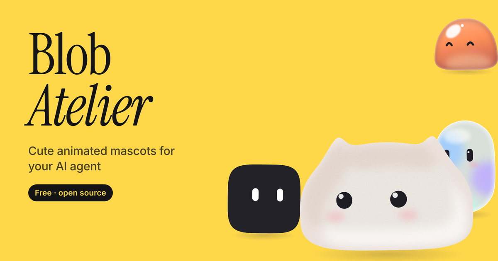
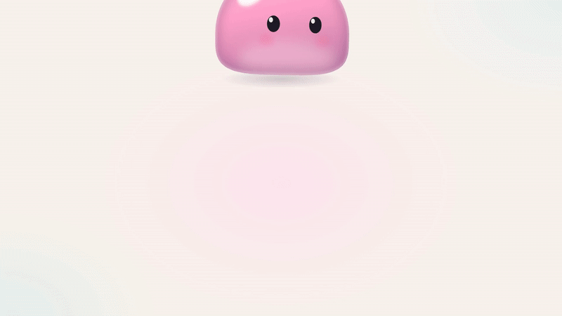
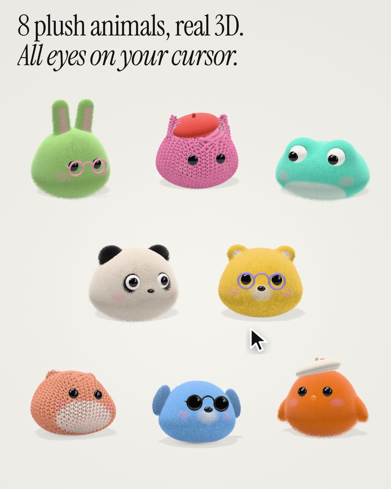

<p align="center">
  <a href="https://victoriawu-77.github.io/blob-atelier/"></a>
</p>

<h1 align="center">Blob Atelier</h1>

<p align="center"><b>Design a cute animated mascot for your AI agent. One HTML file.</b><br>
A free, open-source avatar maker and drop-in <code>&lt;agent-mascot&gt;</code> web component for chatbots, AI assistants and coding agents.</p>

<p align="center">
  <a href="https://victoriawu-77.github.io/blob-atelier/"><b>Try it →</b></a> &nbsp;·&nbsp;
  <a href="assets/promo.mp4">Watch the 30s video</a> &nbsp;·&nbsp;
  <a href="assets/animals.mp4">Watch the Animals video</a> &nbsp;·&nbsp;
  <a href="agent-mascot.js">agent-mascot.js</a> &nbsp;·&nbsp;
  <a href="https://happycapy.ai/share/files/cb21f14b-54a4-4d44-887f-efd64913d895"><b>Remix on Happycapy</b></a>
</p>

<p align="center">
  <a href="https://victoriawu-77.github.io/blob-atelier/"></a>
</p>

---

Pick a shape, a finish and a color, and you get a mouthless little blob that breathes, blinks, follows your cursor and squishes when you poke it. Then drop it into your agent's UI with one tag. It's vanilla JS and inline SVG, with no build step and no dependencies. The Animals series is rendered in real 3D with [three.js](https://threejs.org), which loads from a CDN only when an animal is on screen.

## Animals

<p align="center">
  <a href="https://victoriawu-77.github.io/blob-atelier/#series=animals"></a>
</p>

<p align="center"><a href="assets/animals.mp4"><b>▶ Watch the Animals video</b></a> (30 s, with sound)</p>

The second series is 8 chunky plush toys in real 3D: bunny, cat, dog, frog, hamster, bear, panda and chick. They turn toward your cursor, squish when you poke them, and play all 8 agent states.

- **3 fabric finishes**: long-pile **fluffy** (the default), knitted-yarn **knit** with real stitch relief, and matte needle-felted **felt**
- **Accessories**: a felt **beret**, round **glasses** or **sunglasses**, each in 8 colours (`ink` `cream` `tomato` `blush` `mustard` `sage` `sky` `lilac`, or any hex via `acc-color`)
- **Open them directly**: [`#series=animals`](https://victoriawu-77.github.io/blob-atelier/#series=animals) opens the Animals tab on the default green fluffy bunny with pink glasses. Every design is a link, for example [`#series=animals&shape=cat&material=knit&color=bubblegum&acc=beret&accColor=tomato`](https://victoriawu-77.github.io/blob-atelier/#series=animals&shape=cat&material=knit&color=bubblegum&acc=beret&accColor=tomato)
- **Embed**: `<agent-mascot shape="bunny" material="fluffy" color="matcha" accessory="glasses" acc-color="blush"></agent-mascot>`

## Use it for

- A face for your **AI chat assistant or chatbot**, with states that follow the conversation (listening, thinking, talking)
- A status indicator for **coding agents and background tasks** (working, done, error)
- **Voice agents**, where `talking` pulses in a syllable rhythm without needing a mouth
- Onboarding screens, empty states, loading screens and app icons (export SVG or PNG)
- Stickers and social posts (export GIF or WebM)

## Features

- **Two series**, switched from the tab at the top:
  - **Blobs**: 8 shapes that all morph smoothly into each other (mochi, bean, pebble, squircle, pill, drop, kitty, cloud) and 6 finishes (matte, soft, jelly, frosted glass, clay, velvet)
  - **Animals**: 8 chunky 3D plush toys (bunny, cat, dog, frog, hamster, bear, panda, chick) with glossy bead eyes, in 3 fabric finishes: long-pile **fluffy** (the default), knitted-yarn **knit** and matte needle-felted **felt**. Optional accessories: a felt **beret**, round **glasses** or **sunglasses**. Ears flop and twitch, and the whole toy turns toward your cursor
- **11 colors**, dot or capsule eyes, and optional blush
- **Motion**: spring physics, idle breathing, random blinks, cursor-following eyes with a pseudo-3D turn, and squash-and-stretch when you click or drag
- **8 agent states** you can switch from code (see below)
- **Randomize with taste**: only pairs finishes and colors that work together, and stays inside the series you're in
- **Export** to SVG, PNG (transparent), GIF, WebM (transparent when exported from Chrome or Edge), or an embeddable web component
- Your design is saved in the URL hash, so every mascot is a shareable link

## Embed

```html
<script src="https://victoriawu-77.github.io/blob-atelier/agent-mascot.js"></script>

<agent-mascot shape="mochi" color="peach" material="jelly" eyes="dot" state="idle"
              style="width:240px;height:240px"></agent-mascot>

<agent-mascot shape="bunny" color="sky" material="fluffy" style="width:240px;height:240px"></agent-mascot>
```

```js
const mascot = document.querySelector('agent-mascot');

mascot.setState('thinking');          // switch state
mascot.setConfig({ shape: 'cloud', color: '#9CCBFF', material: 'glass' });
mascot.poke();                        // a little squish
mascot.lookAt(0.5, -0.3);             // hold the gaze (x, y in -1..1); lookAt(null) to release
mascot.toSVGString(512);              // still frame as an SVG string (3D animals embed a PNG frame)
mascot.renderFrame(1024).then(canvas => …);   // still frame on a canvas, works for both series
mascot.addEventListener('poke', () => mascot.setState('happy'));   // fired on click or poke()
mascot.addEventListener('change', e => console.log(e.detail));
```

| Attribute  | Values |
|------------|--------|
| `shape`    | Blobs: `mochi` `bean` `pebble` `squircle` `pill` `drop` `kitty` `cloud` (`bun` still works as an alias)<br>Animals: `bunny` `cat` `dog` `frog` `hamster` `bear` `panda` `chick` |
| `material` | Blobs: `matte` `soft` `jelly` `glass` `clay` `velvet`<br>Animals: `fluffy` (default) `knit` `felt` (`plush`, `wool`, `yarn` and `velour` map to `knit`, `fur` to `fluffy`) |
| `color`    | `milk` `peach` `butter` `matcha` `mint` `sky` `lilac` `bubblegum` `tangerine` `cocoa` `ink`, or any hex |
| `eyes`     | `dot` `capsule` |
| `cheeks`   | `true` `false` |
| `accessory` | `none` `beret` `glasses` `sunglasses` (3D animals only) |
| `acc-color` | Accessory colour: `ink` (default, the original near-black) `cream` `tomato` `blush` `mustard` `sage` `sky` `lilac`, or a `#hex`. Dyes the beret's felt and the glasses/shades frames; sunglass lenses stay dark |
| `state`    | see below |

### How the 3D animals work

Each animal is a signed distance field built from smooth-unioned ellipsoids and round cones, meshed once in the browser (surface nets, a few dozen ms per shape) and cut flat where it sits on the floor. The fur is shell texturing: 9 to 40 instanced layers of the body with a `MeshPhysicalMaterial` (sheen for the velvet glint at grazing angles), where each layer keeps only the pixels inside procedural strands. Lighting is a small PMREM studio environment plus a key, rim and fill light, neutral tone mapping, a soft VSM shadow and a contact shadow on a transparent floor. Eyes, nose and the happy and error eyes are placed by raycasting the actual body surface (the right eye is mirrored for perfect symmetry), lifted by the finish's pile height so they sit on top of the fur, and the fur is trimmed around them so shells never draw over an eye. The badges, sparkles, rings and thought dots stay as crisp SVG on top.

- **Lazy loading**: `agent-mascot.js` stays a single dependency-free file. The first time an animal is shown it runs `import()` on a pinned three.js build (`three@0.170.0` from jsDelivr). Blobs never load it. To self-host, set `AgentMascot.THREE_URL = '/vendor/three.module.min.js'` before the first animal appears.
- **Fallback**: without WebGL2 (or with `AgentMascot.no3D = true`) the animals draw with the SVG fabric filters instead, and that SVG version is also what you see for the moment while three.js downloads.
- **Performance**: all mascots on a page share one WebGL context. Pixel ratio is capped at 2 and steps down by itself if a slow GPU can't keep up (`AgentMascot.adaptive = false` turns that off). Rendering pauses while a mascot is off screen or the tab is hidden.
- **Export**: PNG, GIF and WebM work for animals. SVG export is turned off for them in the app, since a 3D toy isn't vector art.

The SVG finishes for Blobs use filters (`feTurbulence`, `feDisplacementMap`, `feDiffuseLighting`) and stay crisp at any size. `AgentMascot.SERIES` lists the shapes and finishes of each series.

The fabric finishes are drawn with SVG filters (`feTurbulence` fibres, `feDisplacementMap` fuzz and `feDiffuseLighting` for a felted, tufted surface), so they stay crisp at any size and survive SVG, PNG, GIF and WebM export. `AgentMascot.SERIES` lists the shapes and finishes of each series.

## States

| State       | What it does |
|-------------|--------------|
| `idle`      | Breathes, blinks, looks around |
| `listening` | Soft rings pull inward, eyes grow, head tilts and nods |
| `thinking`  | Looks up and to the side, squints, thought dots float up |
| `talking`   | Pulses in a syllable rhythm (no mouth needed) |
| `working`   | Scanning eyes, a busy bob, and a little orbiting dot |
| `happy`     | Hops with squash and stretch, happy eyes, sparkles |
| `done`      | Green check badge and a sparkle burst |
| `error`     | Red "!" badge, `< >` eyes, a small shake and a droop |

## Remix it, no code needed

Don't write code? Open the [Happycapy remix link](https://happycapy.ai/share/files/cb21f14b-54a4-4d44-887f-efd64913d895) and you get your own copy of Blob Atelier. Describe the change you want in plain words, like "add a sleepy state", "make the kitty's ears bigger" or "translate the panel into Japanese", and Happycapy edits the project for you. You can preview your version live and share it.

## Develop

`index.html` and `agent-mascot.js` are built from `src/`:

```sh
node src/build.js
```

There's nothing to install. Open `index.html` in a browser. `test/face-rebuild.test.js` is an optional headless-Chrome check (needs `playwright-core`) that switching shape, finish or eye type while the toy is turned and squashed builds the face exactly like a fresh load. The GIF encoder ([gifenc](https://github.com/mattdesl/gifenc)) loads from a CDN only when you export a GIF, and three.js only when you open an animal. The 3D animals live in `src/animals3d.js`, which the build inlines into the engine.

---

<p align="center">
  Vibe-coded with <a href="https://happycapy.ai">Happycapy</a><br>
  by <a href="https://x.com/victoriawu77">Victoria Wu (@victoriawu77)</a>
</p>

## Contributors

- [Victoria Wu](https://github.com/victoriawu-77) ([@victoriawu77](https://x.com/victoriawu77)): idea, design and direction
- [Happycapy](https://github.com/happycapy-ai) ([happycapy.ai](https://happycapy.ai)): the original app, motion, states and exports, built with Victoria; also hosts the no-code remix
- [Cursor Agent](https://cursor.com): repository setup, v1 import and later polish

Contributions are welcome. Open an issue or a pull request, or [remix it on Happycapy](https://happycapy.ai/share/files/cb21f14b-54a4-4d44-887f-efd64913d895) if you'd rather describe your idea than code it.

## License

[MIT](LICENSE) © 2026 Victoria Wu
